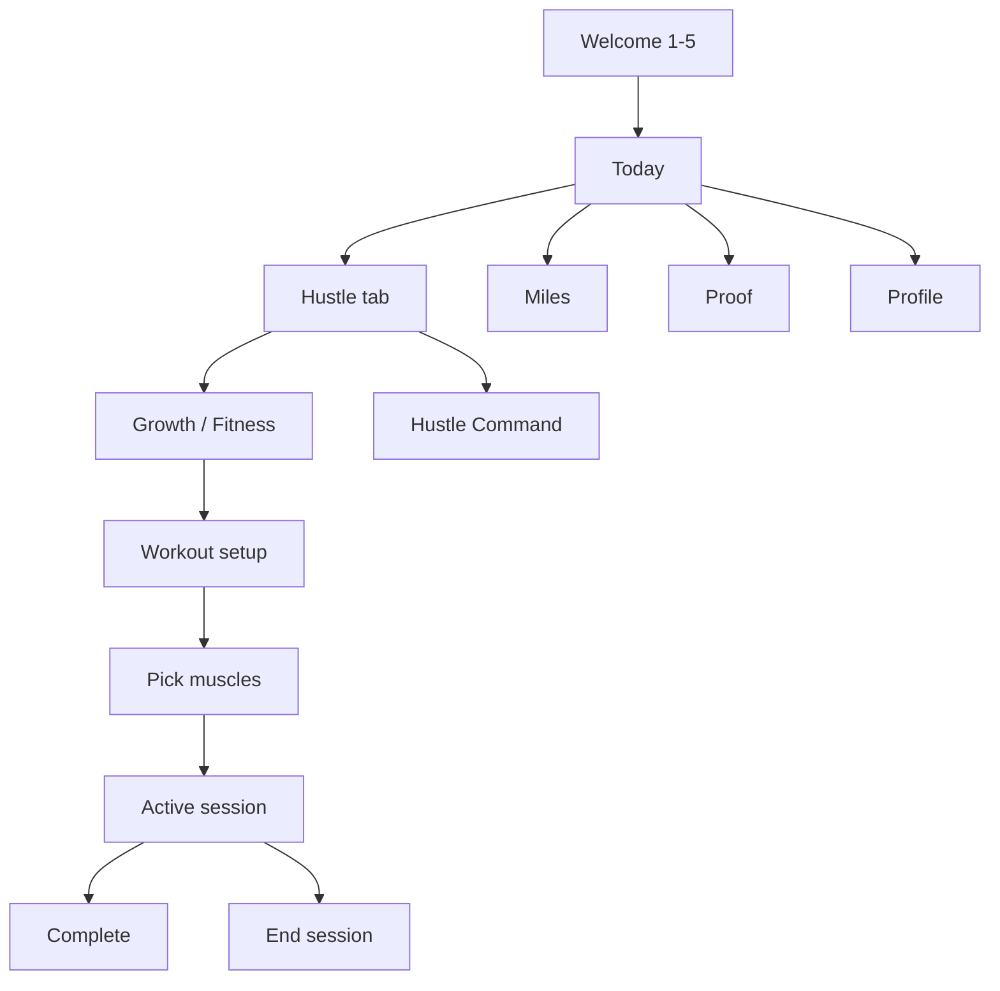

# App flows overview

Marco Locked-In is a local-first PWA: seal the day, prove the week, log the work. Visual tokens live in [`design-system/`](../../design-system/MASTER.md). These docs map **as-built journeys** and a **2026 recommended bar** for retention (ages 16–45).

## App map

| Tab | Simple mode | Full mode |
|-----|-------------|-----------|
| Today | Always | Always |
| Hustle (Growth / Command) | If fitness/hustle unlocked | Same |
| Miles / Money | Hidden until unlock | Visible |
| Proof | Hidden until first core check / unlock | Visible |
| Profile | Always | Always |

**Retention loop:** Check core blocks → seal day → streak identity → optional Fitness depth → Proof / share.

## Button hierarchy (global)

| Level | When | Look |
|-------|------|------|
| Primary | One job per view (Check, Continue, Complete, Save) | `.btn-primary` mint |
| Secondary | Back, Add, Expand | Quiet `.btn` |
| Text link | Demo shortcut, View session, Not now | No chrome |
| Destructive | Reset, Remove profile | `.btn-danger` rare |

Anti-pattern: stacking three equal `.btn` pills. Award-winning apps (Strong, HabitKit, Structured) keep one loud control.

## Recommended 2026 product bar

Compare against: **Strong / Hevy** (workout), **Apple Fitness+** (session clarity), **Streaks / HabitKit** (checks), **Structured / Notion Calendar** (day blocks), **Duolingo / BeReal** (honest activation).

| Principle | Why it retains Gen Z–Millennials |
|-----------|----------------------------------|
| Seal-the-day identity | Streak is the habit; Fitness is depth |
| No clock-lock on checks | Time orders focus; it does not punish early work |
| Type ≥16px body, AA mute | Readability is retention on phones |
| Long-press reorder | Mobile-native (Strong), not grip-only HTML5 DnD |
| End vs Complete | Honest partial seal (Hevy-class) |
| One primary CTA | Stops “every button looks the same” |
| Local-first + Export | Trust; cloud only when retention demands it |

## Recommendations for award-worthy retention

1. **One job per screen, one loud button.** Check / Start / Complete / Save. Secondary as text or overflow.
2. **Seal-the-day as the identity loop** (HabitKit / Streaks). Never clock-lock checks.
3. **Activation under 60s:** name → lane → length → empty Today with one Edit CTA. Cut stacked banners after setup.
4. **Workout UX parity with Strong / Hevy:** long-press reorder, rest timer, session clock, End vs Complete.
5. **Typography as a product feature:** three sizes + AA contrast in every theme.
6. **Share proof, not dashboards:** streak / PR cards for social loops.
7. **Local-first trust:** Export is the account; guest beta slots stay.
8. **Next wedge:** Capacitor + local notifications + home widget, then light accountability (streak-only viewer).
9. **Kill or wire orphan SetupWizard** so onboarding has one brain.
10. **Younger teens (Gen Alpha edge):** larger taps, clear tooltips, no fake urgency.

Cross-links: [onboarding](onboarding.md) · [today](today.md) · [hustle-growth](hustle-growth.md) · [hustle-command](hustle-command.md) · [miles](miles.md) · [proof](proof.md) · [profile](profile.md) · [modals](modals.md)
