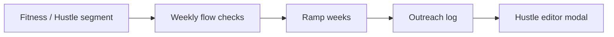

# Hustle → Command center flow

Inner view when `hustleView: hustle` (premium / full hustle modules). UI: `src/ui/Freelance.js` + hustle playbook.

## As-built

| Beat | Actions |
|------|---------|
| Toggle view | `set-hustle-view` |
| Flow checks | `toggle-hustle-check` |
| Packs / editor | `open-hustle-editor`, pack apply |

## Pain points

- Two products under one nav (Growth vs Command) need clear segment contrast
- Premium gate can feel like a wall if preview UX is unclear

## Recommended 2026 journey

Keep **Growth as default** for fitness-first users. Command center is progressive disclosure (Notion-like): brief → flow → log. One primary action: check this week’s Flow item.

**Vs LinkedIn / CRM tools:** no fake pipeline chrome; local checks only.  
**Vs Duolingo streaks:** Monday Flow is the weekly identity beat.

## Button hierarchy

- Primary: check current Flow item
- Secondary: switch Fitness / Hustle, open editor
- Text: pack hints
