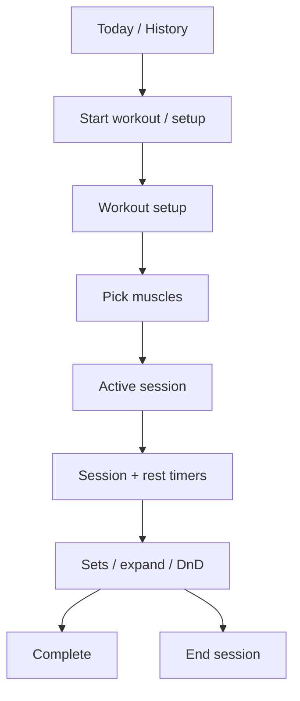

# Hustle → Growth (Fitness) flow

Nav label **Hustle**; inner view `hustleView: fitness`. UI: `src/ui/Fitness.js`, prefs/builder modals.

## As-built

| Beat | Actions |
|------|---------|
| Setup | `open-fitness-prefs`, goals, why train, session minutes |
| Builder | `toggle-muscle-group`, `save-workout-plan` |
| Session | `toggle-session-timer`, set done, rest timer |
| Finish | `complete-workout` or `end-workout-session` |

## Pain points

- Grip-only DnD fails on mobile; can’t drag out of circuit/superset
- Exclusive accordion collapses siblings instantly
- Anatomy clipped; abs/quads and calves/hamstrings mis-hits
- Outcome pre-selected; session labels as `30m`

## Recommended 2026 journey

Strong / Hevy bar: Start timer → log every set → rest → **Complete** or **End session** (partial seal). Long-press reorder. Multi-open exercise cards. Full-body muscle picker with accurate hits.

**Vs Apple Fitness+:** elapsed session time, not a fake countdown limit.  
**Vs Hevy:** End session is first-class, not only “finish all sets.”

## Button hierarchy

- Primary: Complete (when gated ok) / Start (timer)
- Secondary: End session, Add exercise, Expand/Collapse all
- Overflow: session menu (Rebuild, gear, rest presets)
