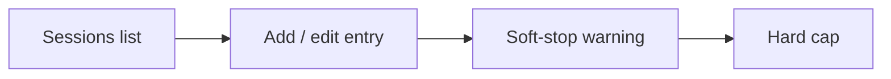

# Miles / Money flow

Tab: Miles (Marco preset) or Money (blank). Soft-stop and hard cap.

## As-built

| Beat | Actions |
|------|---------|
| Log | `uber-form` / `save-uber` |
| Limits | Profile Limits → soft / hard |

## Pain points

- Small mute captions on totals
- Money label only for non-Marco; easy to miss

## Recommended 2026 journey

One log CTA, clear soft-stop banner (not three competing alerts). Caps edited in Profile Limits disclosure.

**Vs Strava / Mint:** truth over gamification; soft-stop is a boundary, not a badge.

## Button hierarchy

- Primary: Log session
- Secondary: Edit entry
- Destructive: Delete (confirm)
