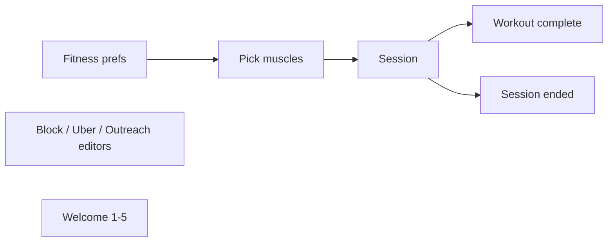

# Modals flow

Shared modal surfaces: Welcome, Workout setup, Pick muscles, Celebrate (complete / ended), editors.

## As-built

| Modal | Primary CTA | Secondary |
|-------|-------------|-----------|
| Welcome | Continue / Start my track | Back; demo text link |
| Fitness prefs | Continue | Cancel / Back |
| Pick muscles | Save · N | Back; Add single exercise |
| Complete / Ended | Done or Share | View session |
| Editors | Save | Cancel |

## Pain points

- Builder scrolled to accessory grid instead of top
- Anatomy clipped in muscle picker
- Complete-only path; no End session celebrate

## Recommended 2026 journey

Sheet = one job. Scroll restores to top on step change. Celebrate screens share one layout system (badge → headline → stats → actions) for Complete and Ended.

**Vs Strong:** finish variants (complete vs end) without redesigning the chrome.

## Button hierarchy

- Primary: mint full-width
- Secondary: quiet Back / Cancel
- Text: Add single exercise, View session, demo link
