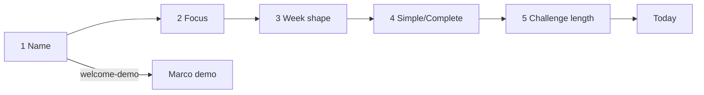

# Onboarding flow

Live path: **Welcome modal** (`src/ui/Welcome.js`). SetupWizard exists but is not opened from boot.

## As-built

| Step | Actions | Notes |
|------|---------|-------|
| 1 | `welcome-name`, `welcome-demo` | Name required; demo skips blank track |
| 2 | `welcome-focus` | Schedule / Fitness / Both |
| 3 | `welcome-toggle-build-day`, `welcome-block-preset`, `welcome-next` | Build days + Morning/Afternoon/Evening |
| 4 | `welcome-mode` → `completeWelcome` | Simple vs Full (`full`) |
| 5 | `welcome-challenge-length`, `welcome-finish` | 7 / 14 / 30 / 90 Premium → `finishOnboarding` |

## Pain points (beta)

- Mute + `text-xs` label hard to read on dark/light/high
- “Try Marco demo” looks like another primary button
- Cards lack tooltips for what Schedule / Fitness / Both actually unlock
- Challenge chips show bare numbers without “Days”

## Recommended 2026 journey

1. Name (large label, bright field)
2. One lane pick with 2-sentence tip
3. Week template (optional collapse)
4. Mode pick
5. Challenge length with “Days”
6. Land on Today with **one** empty-state CTA

**Vs Duolingo / BeReal:** honest, short activation. No fake social proof wall.  
**Vs Structured:** day template early, not buried in settings.

## Button hierarchy

- Primary: Continue / Start my track
- Secondary: Back
- Text link: Try Marco demo instead
