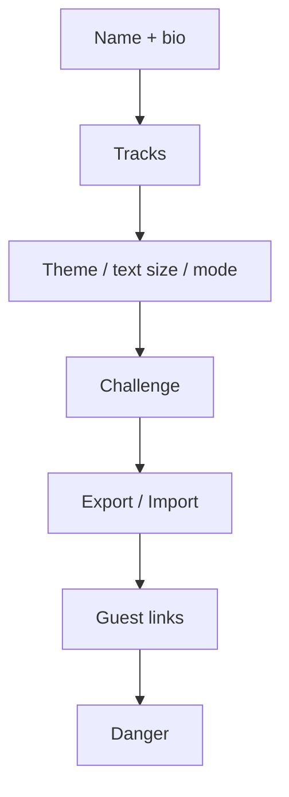

# Profile flow

Identity, tracks, preferences (theme, text size, mode), challenge, data, beta, danger.

## As-built

| Beat | Actions |
|------|---------|
| Identity | `profile-identity` (syncs active track name) |
| Theme | `set-theme` |
| Text size | `set-text-size` default / medium / large |
| Challenge | `set-challenge-length`, Day 30 editor |
| Beta | `copy-guest-link`, insights |

## Pain points

- Dense sections; mute type on help copy
- Beta links easy to miss without a dedicated section (now present)

## Recommended 2026 journey

iOS Settings pattern: identity hero → few prefs → disclosures for Limits / Challenge / Danger. Text size is a first-class a11y control (Apple / Material 2026).

## Button hierarchy

- Primary: Save identity / Export when stale
- Secondary: Add track, Copy guest link
- Destructive: Reset (confirm + export nudge)
