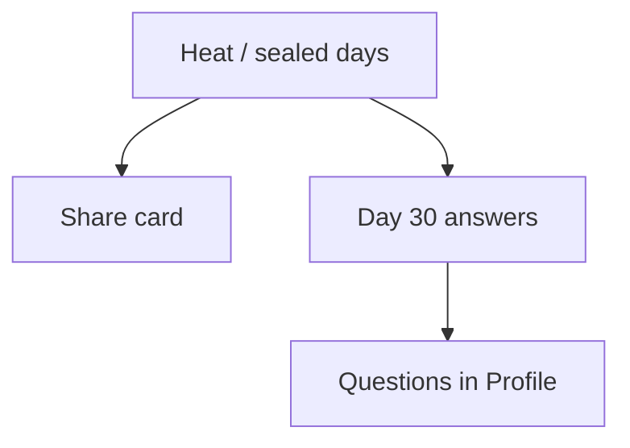

# Proof flow

Heat, week proof, Day 30 review, share.

## As-built

| Beat | Actions |
|------|---------|
| Scope | `proof-share-scope` week / etc. |
| Share | `share-progress` |
| Day 30 | answer fields; questions edited in Profile |

## Pain points

- Unlocks late in Simple mode (by design); empty Proof must explain the gate
- Share must feel like proof, not a dashboard dump

## Recommended 2026 journey

BeReal / Streaks energy: **one card worth posting**. Day 30 is a ritual near the end, not a form wall on day 1.

## Button hierarchy

- Primary: Share
- Secondary: change scope
- Text: edit questions (Profile)
