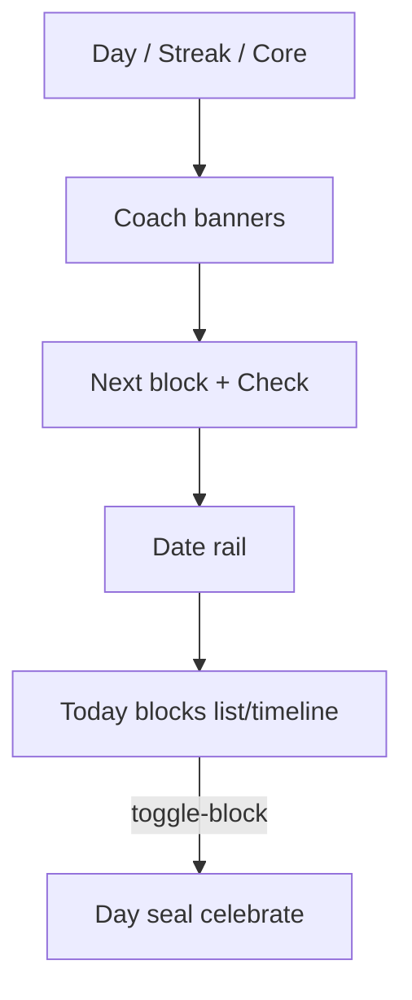

# Today flow

Screen: `src/ui/Today.js`. Default tab after onboarding.

## As-built

| Beat | Actions |
|------|---------|
| Check core | `toggle-block` (day-based `canEdit`; no clock lock) |
| Edit schedule | Today Edit mode / Plan editor |
| Catch-up | Yesterday until midnight if enabled |
| Seal | Core complete → celebrate |

## Pain points

- Stacked banners (no template / export / edit) compete with Check
- Eyebrow and stats use small mute type
- Check control size was oversized historically; now global `.check` is 28px with row hit target

## Recommended 2026 journey

HabitKit / Streaks pattern: **open → see streak → check next block → done**. Time highlights “now”; it never disables checks on an editable day.

**Vs Apple Fitness:** Today is the habit home; workout is a deep link, not the whole product.  
**Vs Structured:** Timeline is optional; List is default for speed.

## Button hierarchy

- Primary: Check (next incomplete core)
- Secondary: Edit (icon)
- Text: coach links (Open Fitness, Export, Open Edit)
